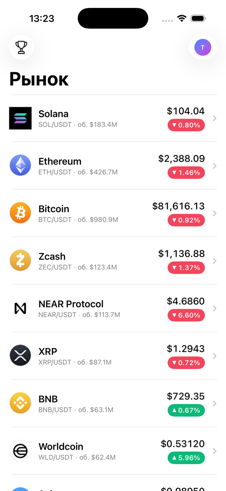
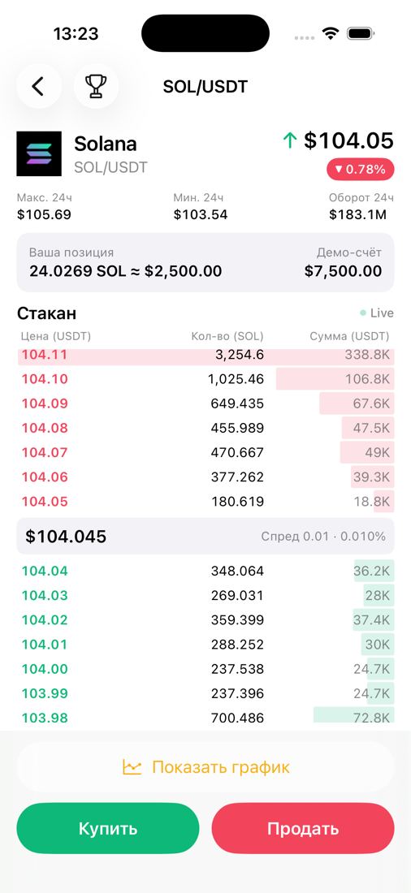
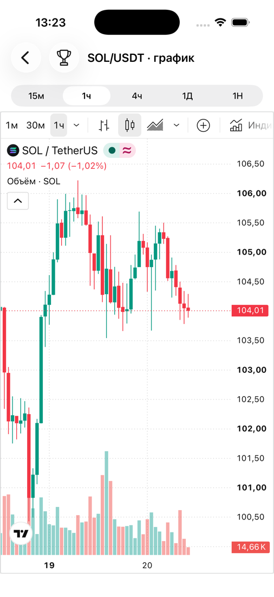
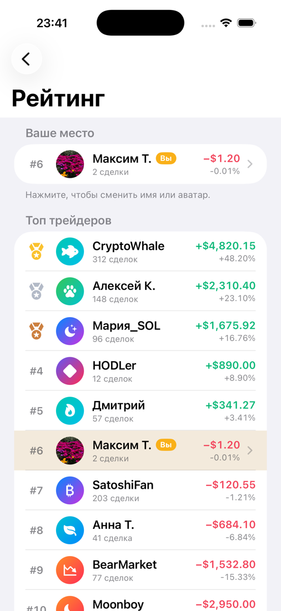
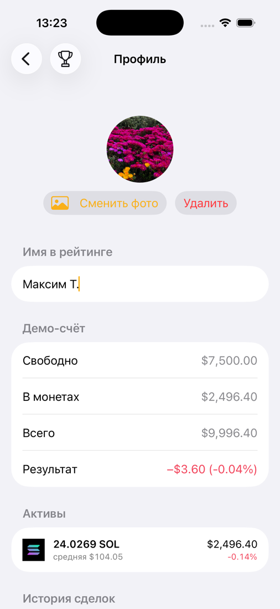

# CryptoTrader — документация

Демо-приложение для торговли криптовалютой на iOS. Пользователь видит рынок, открывает стакан монеты, покупает и продаёт на демо-счёте, смотрит график TradingView и соревнуется с другими трейдерами в рейтинге.

| Рынок | Стакан | График | Рейтинг | Профиль |
|---|---|---|---|---|
|  |  |  |  |  |

---

## 1. Как запустить

**Требования:** Xcode 16 или новее (проверено на Xcode 26.3), iOS 17+, симулятор любого iPhone. Нужен интернет: котировки приходят с Binance.

1. Откройте `CryptoTrader.xcodeproj`.
2. Схема `CryptoTrader`, устройство — например, iPhone 17 Pro.
3. **Run** (⌘R) — запуск, **Test** (⌘U) — 24 юнит-теста.

Ключи API, аккаунты и свой сервер не нужны. Для запуска на реальном iPhone выберите свою команду в *Signing & Capabilities*.

> Проект собран через [XcodeGen](https://github.com/yonaskolb/XcodeGen) из `project.yml`. Если добавили файлы, пересоберите проект командой `xcodegen generate`. Сам `.xcodeproj` тоже лежит в папке, так что XcodeGen для работы не обязателен.

Из терминала:

```bash
xcodebuild -project CryptoTrader.xcodeproj -scheme CryptoTrader -destination 'platform=iOS Simulator,name=iPhone 17 Pro' test
```

Если `xcodebuild` пишет, что выбраны только Command Line Tools, переключитесь на полный Xcode:

```bash
sudo xcode-select -s /Applications/Xcode.app/Contents/Developer
```

---

## 2. Что умеет приложение (по ТЗ)

| Требование ТЗ | Как сделано |
|---|---|
| Список монет (Sol, Ethereum…) | Главный экран «Рынок»: все спотовые пары к USDT с Binance. Solana и Ethereum закреплены сверху, остальные отсортированы по обороту за 24 часа. Бесконечная прокрутка страницами по 20 |
| Экран монеты со стаканом котировок | Стакан на **UIKit `UICollectionView`**, обновляется каждую секунду. Сверху продажи, посередине спред, снизу покупки; полоски на фоне показывают глубину |
| Кнопки «Купить» / «Продать» | **SwiftUI**. Открывают окно сделки: сумма в USDT, быстрые кнопки 25/50/75/100 %, расчёт количества |
| Название и стрелка вверх/вниз | Шапка на SwiftUI: стрелка показывает направление последнего изменения цены, плашка — изменение за 24 часа |
| «Показать график» → TradingView во встроенном WebView | Экран с `WKWebView`, который открывает **ссылку на виджет TradingView**. Данные для графика не загружаются и не рисуются вручную. Таймфреймы: 15м / 1ч / 4ч / 1Д / 1Н |
| Слева вверху всегда переход на рейтинг | Кнопка-кубок в левом верхнем углу на всех экранах. Если рейтинг уже открыт в стеке, кнопка возвращает к нему, а не открывает копию |
| Профиль с аватаркой, изменения видны в рейтинге | Имя и фото (PhotosPicker) сохраняются в SwiftData и сразу появляются в рейтинге через поток обновлений |
| Таббара нет, переходы через навигацию | Один `NavigationStack` с путём в роутере |
| UITableView | Список рейтинга трейдеров — `UITableView` с diffable data source, своими UIKit-ячейками и pull-to-refresh |
| Мост UIKit ↔ SwiftUI | `UIViewRepresentable` для стакана (`UICollectionView`), рейтинга (`UITableView`) и графика (`WKWebView`) |
| База данных — SwiftData | Профиль, баланс, позиции и история сделок. UserDefaults не используется: всё лежит в одной базе |
| Свой сервер не нужен, обмен данными — через публичный API | Binance REST API без ключа. Рейтинг других трейдеров — заглушка «сервера» за протоколом |
| Демо-счёт: сделка фиксирует текущую цену | Стартовый баланс $10,000. Покупка исполняется по лучшей цене продавца (best ask), продажа — по лучшей цене покупателя (best bid) из текущего стакана |
| SOLID, данные отделены от представления | Слои Presentation → Domain ← Data; экраны не обращаются к сети и базе напрямую |
| View знает только протокол ViewModel | Все экраны generic: `CoinListView<ViewModel: CoinListViewModelProtocol>` и т.д. |
| Swift Concurrency + continuation | `withCheckedThrowingContinuation` в сетевом клиенте, `AsyncStream.Continuation` для живых данных и подписок, акторы, `async let`, `TaskGroup` |

---

## 3. Архитектура

```
┌──────────────────────── Presentation (SwiftUI + UIKit) ────────────────────────┐
│  View<VM: Protocol>  ──знает только──▶  ViewModelProtocol  ◀── ViewModel        │
│  (CoinListView, CoinDetailView, …)                         (@Observable,        │
│                                                              @MainActor)        │
│  Стакан (UICollectionView), рейтинг (UITableView), WKWebView — UIViewRepresentable │
└──────────────────────────────────────┬──────────────────────────────────────────┘
                                       │ зависит от протоколов
┌──────────────────────────────── Domain ──────────────────────────────────────────┐
│  Модели: Coin, OrderBook, Portfolio, UserProfile, LeaderboardEntry…  (Sendable)  │
│  Протоколы репозиториев: MarketRepositoryProtocol, PortfolioRepositoryProtocol…  │
│  Сервисы: TradingService, LiveMarketService, LeaderboardService, Valuation       │
└──────────────────────────────────────▲──────────────────────────────────────────┘
                                       │ реализует протоколы
┌──────────────────────────────────── Data ────────────────────────────────────────┐
│  BinanceMarketRepository (actor) ── URLSessionHTTPClient (continuation)           │
│  SwiftDataProfileRepository / SwiftDataPortfolioRepository (@ModelActor)          │
│  MockLeaderboardRepository · TradingViewChartURLProvider · AvatarImageProcessor   │
└───────────────────────────────────────────────────────────────────────────────────┘
        Сборка всех зависимостей — только в App/AppDependencies.swift (composition root)
```

### Структура папок

```
.
├── README.md                 эта документация
├── docs/screenshots/         скриншоты экранов
├── CryptoTrader.xcodeproj    проект Xcode
├── project.yml               описание проекта для XcodeGen
├── CryptoTrader/             исходный код приложения
└── CryptoTraderTests/        юнит-тесты
```

Исходный код:

```
CryptoTrader/
├── App/            точка входа, composition root, фабрика экранов, корневой NavigationStack
├── Core/           расширения Decimal, форматирование чисел
├── Domain/         модели, протоколы репозиториев, бизнес-сервисы — без UIKit/SwiftUI/SwiftData
├── Data/           Binance API, сеть, SwiftData, заглушка рейтинга, TradingView, обработка фото
├── Presentation/   экраны: CoinList, CoinDetail (+ OrderBook на UIKit), Chart, Leaderboard, Profile
└── Resources/      ассеты, иконка
CryptoTraderTests/  юнит-тесты (Swift Testing)
```

### Как экран получает данные (на примере стакана)

1. `ScreenFactory` создаёт `CoinDetailViewModel` и передаёт ему протоколы `LiveMarketServiceProtocol`, `PortfolioRepositoryProtocol`, `TradingServiceProtocol` и `AppRouting`.
2. `CoinDetailView` в `.task` вызывает `viewModel.startLiveUpdates()`.
3. ViewModel подписывается на `liveMarketService.snapshots(...)`, то есть на `AsyncStream`. Сервис раз в секунду параллельно (`async let`) запрашивает тикер и стакан у репозитория и кладёт результат в поток через `continuation.yield`.
4. ViewModel обновляет `coin` и `orderBook`, после чего SwiftUI перерисовывает шапку, а `OrderBookCollectionView.updateUIView` передаёт новый стакан в `UICollectionView`.
5. Когда экран закрывается, SwiftUI отменяет `.task`, поток завершается, срабатывает `onTermination`, и опрос сети прекращается.

---

## 4. Какая функция чем реализована

### Главный экран: список монет

| Что | Чем реализовано | Где |
|---|---|---|
| Экран и строки | SwiftUI `List`, `AsyncImage` для иконок | `Presentation/CoinList/CoinListView.swift` |
| Логика и пагинация | `CoinListViewModel`: страницы по 20, следующая грузится за 5 строк до конца, pull-to-refresh, ошибка с кнопкой «Повторить» | `Presentation/CoinList/CoinListViewModel.swift` |
| Данные | `GET /api/v3/ticker/24hr?type=MINI` — одним запросом снимок всего рынка. Репозиторий фильтрует пары к USDT, убирает стейблкоины, сортирует и отдаёт страницы из кэша (60 с). Binance не умеет пагинировать тикеры на сервере, поэтому страницы режутся на клиенте | `Data/Binance/BinanceMarketRepository.swift` |
| Названия монет | Binance отдаёт только тикер, поэтому для популярных монет есть словарь названий | `Data/Binance/BinanceMapper.swift` → `CoinNameCatalog` |
| Иконки | Открытый CDN `assets.coincap.io`; если иконки нет — тикер на цветном кружке | `Presentation/Common/CommonViews.swift` → `CoinIconView` |

### Экран монеты: стакан и сделки

| Что | Чем реализовано | Где |
|---|---|---|
| Стакан | **UIKit**: `UICollectionView` + `UICollectionViewCompositionalLayout` + `UICollectionViewDiffableDataSource`. Идентификатор ячейки — её позиция (секция + индекс), поэтому каждую секунду содержимое обновляется через `reconfigureItems`, без пересоздания ячеек и мерцания. Если число уровней меняется — `applySnapshotUsingReloadData`. При первом показе спред прокручивается в центр | `Presentation/CoinDetail/OrderBook/OrderBookView.swift` |
| Ячейки | `OrderBookLevelCell` (цена, количество, сумма, анимированная полоска глубины) и `OrderBookSpreadCell` | `.../OrderBook/OrderBookCells.swift` |
| Мост в SwiftUI | `OrderBookCollectionView: UIViewRepresentable` | `.../OrderBook/OrderBookCollectionView.swift` |
| Шапка, позиция, кнопки | SwiftUI: стрелка тика с `contentTransition(.symbolEffect)`, цена с `.numericText()`, индикатор Live | `Presentation/CoinDetail/CoinDetailView.swift` |
| Живые данные | `PollingLiveMarketService`: `AsyncStream` + `continuation`, опрос раз в секунду, `async let` для тикера и стакана, буфер `.bufferingNewest(1)`. Ошибки не обрывают поток | `Domain/Services/LiveMarketService.swift` |
| Эндпоинты | `GET /api/v3/depth?symbol=SOLUSDT&limit=15`, `GET /api/v3/ticker/24hr?symbol=SOLUSDT&type=MINI` | `Data/Binance/BinanceAPI.swift` |
| Окно сделки | SwiftUI sheet: сумма в USDT, кнопки 25/50/75/100 %, валидация («недостаточно средств», минимум $1, «у вас нет SOL»). Кнопка 100 % на продаже продаёт ровно всю позицию, без остатка от округления | `Presentation/CoinDetail/TradeSheetView.swift`, `CoinDetailViewModel.quote` |
| Бизнес-логика сделки | `TradingService` переводит сумму в количество (8 знаков, округление вниз) и проверяет входные данные | `Domain/Services/TradingService.swift` |
| Исполнение | `SwiftDataPortfolioRepository.execute`: проверка баланса и запись идут в одном вызове актора, поэтому две параллельные покупки не потратят одни и те же деньги. Средняя цена позиции пересчитывается при докупке | `Data/Persistence/SwiftDataPortfolioRepository.swift` |

### График

| Что | Чем реализовано | Где |
|---|---|---|
| Экран | SwiftUI: сегменты таймфреймов, индикатор загрузки, экран ошибки с «Повторить» | `Presentation/Chart/ChartView.swift` |
| WebView | `TradingViewWebView: UIViewRepresentable` над `WKWebView`. Страница перезагружается только при смене URL (интервал, светлая/тёмная тема) или по «Повторить». `WKNavigationDelegate` сообщает о загрузке во ViewModel | там же |
| Ссылка | `https://s.tradingview.com/widgetembed/?symbol=BINANCE:SOLUSDT&interval=60&theme=dark&locale=ru…` | `Data/Chart/TradingViewChartURLProvider.swift` |

### Рейтинг трейдеров

| Что | Чем реализовано | Где |
|---|---|---|
| Экран | SwiftUI-обёртка: загрузка и ошибка на SwiftUI, сам список — UIKit | `Presentation/Leaderboard/LeaderboardView.swift` |
| Список | **UIKit `UITableView`** (`.insetGrouped`) + `UITableViewDiffableDataSource`: «Ваше место» закреплено сверху, своя строка подсвечена в общем списке, медали для топ-3. Изменения имени, аватара и P&L применяются через `reconfigureItems`, обновление — `UIRefreshControl` | `Presentation/Leaderboard/LeaderboardTableView.swift`, `LeaderboardCell.swift` |
| Аватары | Одна палитра градиентов для SwiftUI `AvatarView` и UIKit `AvatarUIView`, чтобы пользователь выглядел одинаково на всех экранах | `Presentation/Common/AvatarPalette.swift`, `AvatarUIView.swift` |
| Сбор рейтинга | `LeaderboardService`: параллельно (`async let`) загружает трейдеров, профиль и портфель, оценивает портфель по текущим ценам и сортирует по доходности | `Domain/Services/LeaderboardService.swift` |
| Другие трейдеры | `MockLeaderboardRepository` — заглушка сервера с задержкой 300 мс. Для настоящего бэкенда достаточно другой реализации `LeaderboardRepositoryProtocol` | `Data/Leaderboard/MockLeaderboardRepository.swift` |
| Оценка портфеля | `PortfolioValuationService`: `GET /api/v3/ticker/price?symbols=[...]`. Без сети позиции оцениваются по цене покупки с пометкой | `Domain/Services/PortfolioValuationService.swift` |
| Живое обновление имени и аватара | ViewModel подписан на `profileRepository.updates()`. Последний профиль из потока накладывается на каждую загрузку, чтобы медленный `load()` не вернул старое имя | `Presentation/Leaderboard/LeaderboardViewModel.swift` |

### Профиль

| Что | Чем реализовано | Где |
|---|---|---|
| Экран | SwiftUI `Form`: аватар, имя, демо-счёт (свободно / в монетах / всего / результат), активы, история сделок, сброс счёта | `Presentation/Profile/ProfileView.swift` |
| Выбор фото | `PhotosPicker` (без запроса доступа к галерее) → `loadTransferable(type: Data.self)` | там же |
| Обработка фото | ImageIO в фоне (`Task.detached`): уменьшение с учётом EXIF-ориентации, обрезка до квадрата, JPEG. В базу не попадают многомегабайтные оригиналы | `Data/Images/AvatarImageProcessor.swift` |
| Сохранение имени | Автосохранение через 600 мс после ввода (`.task(id:)` как debounce), плюс по Return, при потере фокуса и при уходе с экрана | `ProfileView` / `ProfileViewModel.autosaveName` |
| Подписки | `withTaskGroup`: одна группа слушает и профиль, и портфель | `Presentation/Profile/ProfileViewModel.swift` |

### Навигация

| Что | Чем реализовано | Где |
|---|---|---|
| Стек | `NavigationStack(path:)` + `navigationDestination(for: Route.self)` | `App/RootView.swift` |
| Маршруты | `enum Route { coinDetail, chart, leaderboard, profile }` | `Presentation/Navigation/AppRouter.swift` |
| Роутер | `AppRouter` (`@Observable`) за протоколом `AppRouting`: ViewModel вызывают `router.push(...)` и не знают про SwiftUI | там же |
| Кнопка рейтинга | Модификатор `.leaderboardButton { viewModel.openLeaderboard() }` — `ToolbarItem(placement: .topBarLeading)` | там же |
| Сборка экранов | `ScreenFactory` создаёт ViewModel с зависимостями и передаёт во View | `App/ScreenFactory.swift` |

---

## 5. Многопоточность: Swift Concurrency и continuation

| Приём | Где и зачем |
|---|---|
| `withCheckedThrowingContinuation` | `URLSessionHTTPClient.perform`: callback-API `dataTask(completionHandler:)` превращается в `async throws`. Continuation возобновляется ровно один раз — в completion handler |
| `withTaskCancellationHandler` | Там же: отмена Swift-задачи (например, закрыли экран) отменяет `URLSessionDataTask`. `DataTaskBox` под `NSLock` учитывает гонку, когда отмена приходит раньше создания задачи |
| `AsyncStream` + `Continuation` | 1) `PollingLiveMarketService` — живой поток стакана; `onTermination` останавливает опрос. 2) `updates()` в SwiftData-репозиториях — подписки на профиль и портфель: каждый подписчик получает свой continuation, а репозиторий рассылает изменения через `yield` |
| `actor` | `BinanceMarketRepository` защищает кэш снимка рынка |
| `@ModelActor` | SwiftData-репозитории работают со своим `ModelContext` на фоновом исполнителе, а не на главном потоке. Наружу выходят только `Sendable`-структуры |
| `@MainActor` | Все ViewModel и роутер: состояние UI меняется только на главном потоке |
| `async let` | `LiveMarketService` (тикер ∥ стакан), `LeaderboardService` (трейдеры ∥ профиль ∥ портфель) |
| `withTaskGroup` | `ProfileViewModel.observeChanges` — две подписки в одной группе |
| `Task.detached` | `AvatarImageProcessor` — обработка фото с повышенным приоритетом вне главного актора |
| `.task` / `.task(id:)` | Жизненный цикл: при уходе с экрана задачи отменяются автоматически; `.task(id:)` используется как debounce для имени и автоскрытия уведомления |

Проект собирается в режиме **Swift 6** (полная проверка data races) без предупреждений.

---

## 6. Хранение данных — SwiftData

| Модель | Поля | Примечание |
|---|---|---|
| `ProfileEntity` | имя, аватар | `@Attribute(.externalStorage)` для картинки |
| `AccountEntity` | свободные деньги, начальный баланс | создаётся с $10,000 при первом обращении |
| `HoldingEntity` | пара, количество, средняя цена | `@Attribute(.unique)` по символу |
| `TradeEntity` | сторона, количество, цена, дата | история; в домен отдаются последние 50 |

Все деньги и количества хранятся в `Decimal`, а не в `Double`, поэтому 0.1 + 0.2 = 0.3. Это проверено тестом, который пишет данные в SwiftData и читает их обратно. Цены от Binance приходят строками и разбираются сразу в `Decimal`.

Файл `PersistenceModels.swift` → `PersistenceContainer` создаёт контейнер. Если хранилище повреждено, релизная сборка не падает, а работает в памяти. В отладке в этом случае срабатывает `assertionFailure`, чтобы проблему заметили.

---

## 7. SOLID в проекте

- **S** — каждый тип отвечает за одно: `BinanceMapper` только переводит DTO в модели, `TradingService` считает сделку, `PortfolioRepository` хранит, `OrderBookView` рисует.
- **O** — новый источник данных (например, Bybit или свой сервер рейтинга) добавляется новой реализацией протокола без правок ViewModel.
- **L** — в тестах вместо Binance и SwiftData подставляются заглушки (`StubMarketRepository`, `SpyPortfolioRepository`), и ViewModel работают с ними так же.
- **I** — узкие протоколы: `ChartURLProviding`, `AvatarProcessing`, `LeaderboardNavigable`. Каждый ViewModel получает только нужное.
- **D** — протоколы объявлены в Domain, реализации лежат в Data, а соединяются только в `AppDependencies`. View зависит от протокола ViewModel, а не от класса.

---

## 8. Тесты

24 теста на Swift Testing (`CryptoTraderTests/`), все проходят:

- **Демо-счёт в SwiftData** (in-memory база): стартовый баланс; покупка списывает деньги; усреднение цены; продажа всей позиции; нельзя потратить больше баланса и продать больше, чем куплено; сброс; точность `Decimal` после сохранения; поток `updates()` рассылает изменения.
- **Торговый сервис**: перевод суммы в количество с округлением вниз; минимум $1; нулевая цена.
- **Рейтинг**: место пользователя по доходности; оценка без сети по цене покупки.
- **Разбор Binance**: тикер → монета; пары не к USDT отбрасываются; стакан и спред; кодирование списка пар в URL.
- **ViewModel** (на заглушках): пагинация до конца списка; показ ошибки; навигация; покупка на 50 % баланса; запрет продажи без позиции; рейтинг не затирает свежее имя.

---

## 9. Допущения и ограничения

- **Свой сервер не нужен.** Рыночные данные берутся из публичного API Binance. Рейтинг других трейдеров — фиксированная заглушка, потому что у публичных API нет «других пользователей приложения».
- **Данные Binance вместо TradingView.** У TradingView нет бесплатного публичного API с котировками, поэтому оттуда берётся только график-виджет по ссылке, как и обсуждалось. Стакан и цены идут с Binance.
- **Опрос вместо WebSocket.** Стакан обновляется REST-запросом раз в секунду: так проще и надёжнее для демо. Для продакшена лучше подключить WebSocket `wss://stream.binance.com/ws/<symbol>@depth20`; это будет ещё одна реализация `LiveMarketServiceProtocol`.
- **Регион.** Если `api.binance.com` недоступен в вашей стране (HTTP 451), смените `BinanceAPI.baseURL` на зеркало рыночных данных `https://data-api.binance.vision`.
- **Эмодзи не используются.** В некоторых рантаймах симулятора нет эмодзи-шрифта, поэтому аватары трейдеров и медали нарисованы SF Symbols.
- **Комиссий и проскальзывания нет**: сделка целиком исполняется по лучшей цене стакана.

---

## 10. Что проверено вручную

Приложение запускалось из Xcode 26.3 на симуляторе iPhone 17 Pro (iOS 26.3). Пройдено:

1. Рынок загружается: SOL и ETH сверху, цены и изменения за 24 часа отображаются.
2. Экран SOL: стакан обновляется каждую секунду, спред по центру, индикатор Live.
3. Покупка на 25 % ($2,500): позиция 24.03 SOL, на счёте осталось $7,500.
4. График TradingView открывается, таймфреймы переключаются.
5. Рейтинг открывается кнопкой-кубком с любого экрана, моё место пересчитывается после сделки.
6. Профиль: смена имени и фото сразу видна в рейтинге и сохраняется после перезапуска.
7. Продажа на 100 %: позиция закрывается полностью, деньги возвращаются на счёт.
